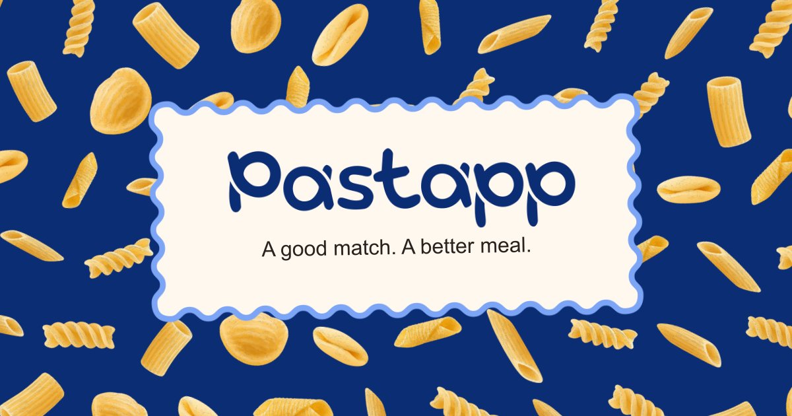

# Pastapp

Find your pasta pairing, then cook a meal for two.

Start with a pasta shape, pick a sauce, or let **Surprise me** choose a compatible pairing. Each recipe includes ingredients, cooking steps, timing, and sauce dietary badges, with a PNG download to keep it handy in the kitchen.

## Features

- 14 pasta shapes, 24 sauces, and 96 curated pairings.
- Pasta-first and sauce-first selection flows, with shareable recipe links.
- Illustrated pasta and ingredients, plus an interactive pasta physics scene.
- Light and dark themes that follow your system preference. Press `D` to switch.
- A mobile-first layout with a centered desktop shell.

The catalog lives in TypeScript. No backend, database, authentication, or environment variables are required.

## Run locally

With Node.js and pnpm installed, run:

```bash
pnpm install
pnpm dev
```

Open [localhost:3000](http://localhost:3000).

To build and serve the production app:

```bash
pnpm build
pnpm start
```

Builds fetch Google fonts through `next/font/google`, so network access is needed.

## Development

Built with Next.js 16 App Router, React 19, strict TypeScript, Tailwind CSS 4, shadcn/ui with Base UI, Lucide icons, Motion, next-themes, and Matter.js. Recipe images are exported with html-to-image. See [package.json](package.json) for dependencies and scripts.

| Command | Purpose |
| --- | --- |
| `pnpm dev` | Start the development server |
| `pnpm build` | Build for production |
| `pnpm start` | Serve the production build |
| `pnpm lint` | Run ESLint |
| `pnpm typecheck` | Check TypeScript without emitting files |
| `pnpm format` | Format all TypeScript and TSX files |
| `pnpm generate:pasta-physics` | Regenerate collision geometry from pasta SVGs |

There is no test runner or `check` script configured. Use `pnpm lint` and `pnpm typecheck` for code checks; run `pnpm build` for changes affecting rendering or production behavior.

### Navigation and catalog

The app uses a single route, `/`, with URL fragments for its screens. A recipe link looks like:

```text
/#result?pasta=spaghetti&sauce=carbonara&from=pasta
```

Keep catalog IDs stable so existing links and artwork mappings continue to work. Sauce `pastaIds` define compatibility; pasta matches and the shared pairing list are derived from them.

Recipes serve two people. Dietary badges describe the sauce; the selected pasta may contain eggs or dairy. Keep catalog edits aligned with the [catalog reference](docs/sample-catalog.md) and artwork mappings.

Read [AGENTS.md](AGENTS.md) for contribution conventions and verification guidance. After editing pasta SVGs, regenerate the collision geometry with `pnpm generate:pasta-physics`.

## License

[MIT](LICENSE) © 2026 Agostina Colantuoni.
